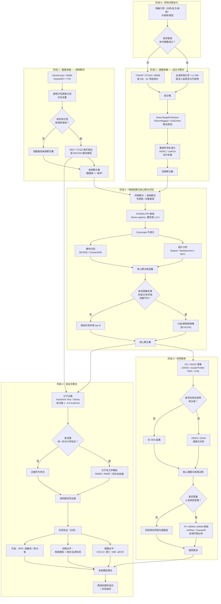

以下是一条通用、标准化、不绑定特定疾病或药味的网络药理学研究技术路线。它整合了经典流程与近年的规范化进展（如入血成分优先、多组学整合、分层验证），可直接作为大多数网络药理学研究的**基线模板**。

## 路线图的关键逻辑与当前最佳实践

**阶段 0 是路线图的分叉起点**。是否以“入血成分”为起点，决定了后续成分集的证据等级。以血清药物化学或LC-MS鉴定入血原型/代谢物，是将“体外成分”推进到“体内暴露成分”的关键一步，也是当前高质量网络药理学研究区别于纯数据库挖掘的标志之一。若不具备条件，TCMSP的OB≥30%、DL≥0.18仍是可接受的基线筛选标准。

**阶段 1 的核心操作是标准化与合并**。不同数据库返回的基因标识符形式不一（Symbol、UniProt ID、Ensembl ID、别名），必须在交集之前统一为HGNC官方符号，否则交集筛选会因命名不一致而产生大量假阴性和假阳性。疾病端是否引入GEO/TCGA的差异表达或WGCNA模块基因，决定了疾病靶点集是“数据库注释的”还是“数据驱动的”，两者可以并列纳入，形成互补。

**阶段 2 的决策点是核心靶点识别策略**。对于常规的单药/简单复方，STRING PPI + Degree/Betweenness/MCC + MCODE即可满足需求；但如果涉及多药味配伍且各药味靶点数量悬殊，或需要识别跨模块桥接靶点，则应在拓扑分析之上引入分层/跨网络策略（如HCHA），否则次要药味的关键靶点会被优势药味的高度节点系统性遮蔽。

**阶段 3 的决策点是富集分析的深度**。ORA（GO/KEGG）是基线，但只利用“是否在列表中”的信息；若有表达矩阵和分组，GSEA/GSVA能补充通路激活/抑制的方向性，避免“通路显著但不知是上调还是下调”的模糊结论。TF–miRNA–mRNA调控网络则是在通路富集之上追问“谁在上游调控这些通路”，但其输出本质上是数据库注释整合，需要以表达负相关或因果证据加以约束，而非直接作为因果结论。

**阶段 4 的验证是分层的，而非“有无实验”的二元判断**。分子对接（结合能≤−5.0 kcal/mol）是结构层面的最低验证；若需判断结合稳定性，可叠加100 ns级分子动力学模拟（RMSD/RMSF）。实验验证应优先针对**少数高优先级靶点/通路**，而非对全部计算预测进行穷举：细胞水平（WB/qPCR/CCK-8/凋亡）回答“是否调控”，动物水平回答“在疾病模型中是否成立”，SPR或类器官则提供直接结合或人源化验证的可选层。当前“精准网络药理学”共识进一步强调**成分验证—药效验证—分子机制验证**的三重闭环，以及多组学与多网络的双重整合，可作为路线图向更高证据等级升级的参照。

简言之，这条路线图的可迁移性来自其**分层决策结构**：每一阶段都有一个明确的“是否/如何深入”的判断点，研究者可以根据数据可及性、疾病复杂度和目标期刊的证据要求，在基线模板上选择性地向上叠加组学、分层网络、动力学模拟或实验验证，而不必从零设计流程。